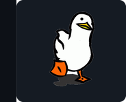

## <picture><source media="(prefers-color-scheme: light)" srcset="passaro-claro.png"></picture> 👋 Olá, eu sou o Gabriel dos Santos

💻 Desenvolvedor **freelancer**: programas para Windows, apps e sites. 
🎓 Estudei Desenvolvimento de Sistemas (SENAI) e Design de Interiores (UEMA). 
📍 Bacabal - MA, Brasil.

 

### 🛠️ Tecnologias

  
  
  
  
  
  

### 🚀 Projetos atuais

> Projetos privados: o código não está aberto ao público.

| Projeto | O que faz |
|---|---|
| **Concord** | App de conversa por texto, voz e transmissão de tela, feito com um grupo de amigos |
| **NexusMIDI** | Toca um teclado MIDI (cabo ou Bluetooth) no computador e manda voz + teclado para o Discord |
| **NexusMIDI Android** | Versão para Android do NexusMIDI |
| **Gerador de Rifas** | Gera rifas por aluno (PDF/Excel) a partir de um modelo |
| **Site Aridson e Jucilene** | Site de uma empresa de decorações e eventos |

### 📊 Linguagens mais usadas

### 📫 Contato

  
  
  

---

<b>🇺🇸 English</b>

## 👋 Hi, I'm Gabriel dos Santos

💻 **Freelance** developer: Windows programs, apps and websites. 
🎓 Studied Systems Development (SENAI) and Interior Design (UEMA). 
📍 Bacabal - MA, Brazil.

### 🚀 Current projects

> Private projects: the source code is not public.

| Project | What it does |
|---|---|
| **Concord** | Text, voice and screen-sharing chat app, built with a group of friends |
| **NexusMIDI** | Plays a MIDI keyboard (cable or Bluetooth) on the PC and sends voice + keyboard to Discord |
| **NexusMIDI Android** | Android version of NexusMIDI |
| **Raffle Generator** | Generates raffle tickets per student (PDF/Excel) from a template |
| **Aridson & Jucilene website** | Website for a decoration and events company |

